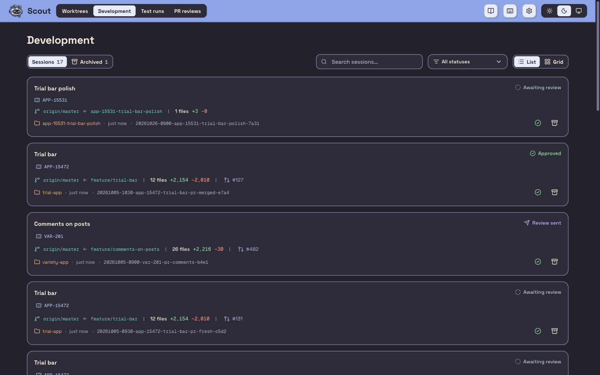
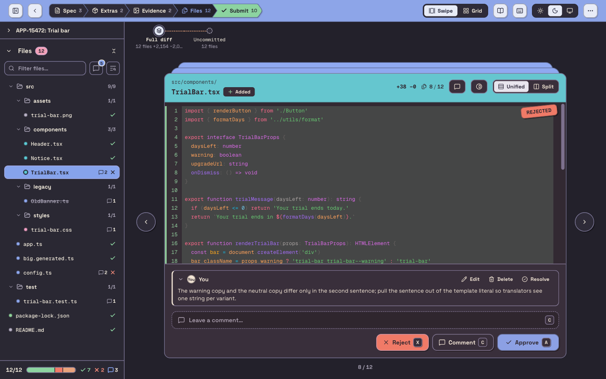
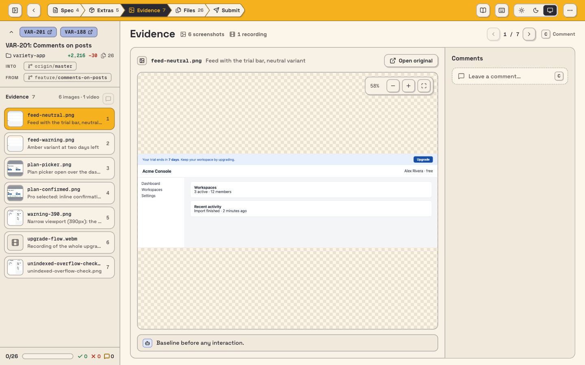
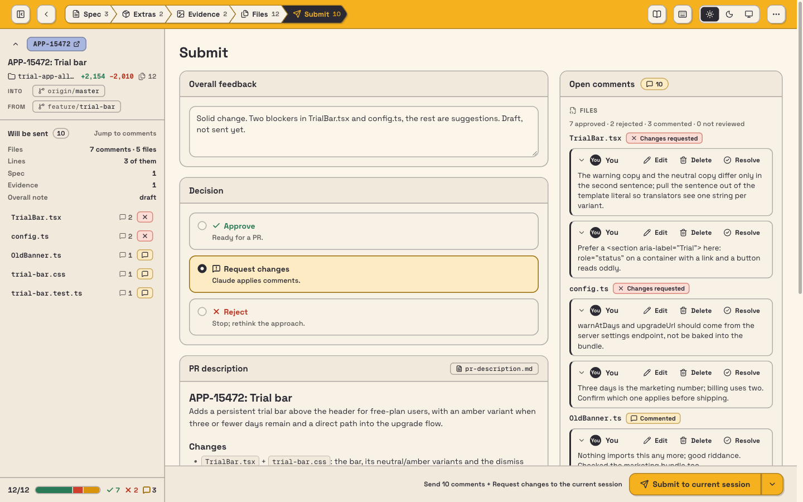
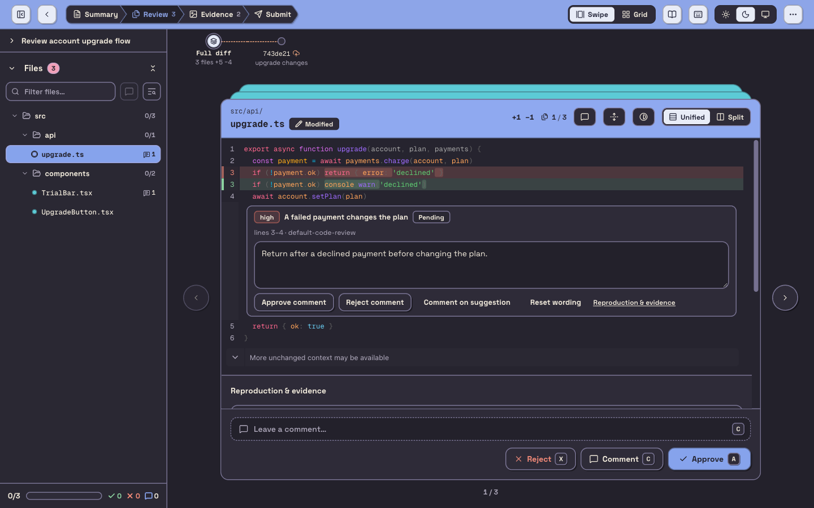
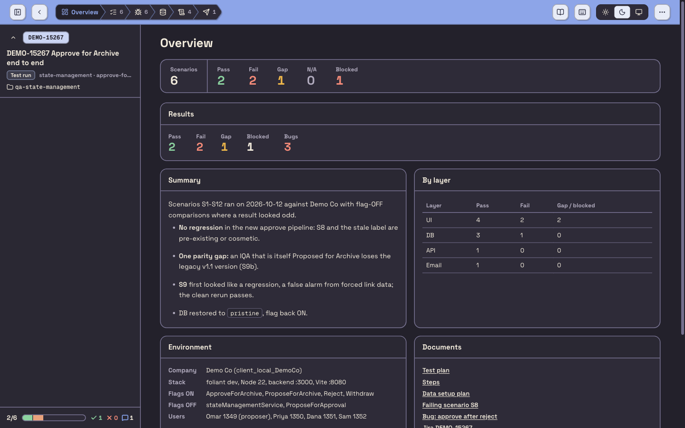
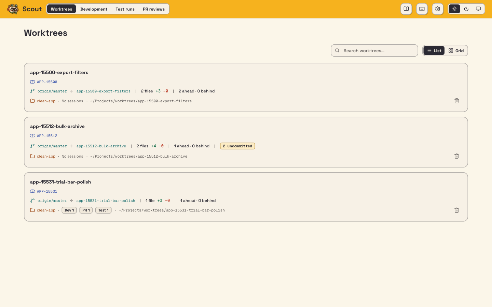

<p align="center">
  
</p>

# Scout

A local dashboard for reviewing an AI agent's work. You see its changes, evidence and notes side by side,
approve or comment, and the feedback goes back to the Claude Code (or Codex) session that did the work. It reads
the repository's working tree live, so nothing needs republishing.

| Page | Shows |
|---|---|
| `/` Worktrees | Git worktrees in the folders picked in Settings, with branch, changes, PR and linked sessions |
| `/d` Development | Reviews of an agent's work on a branch |
| `/pr` PR review | A pull request's summary, tickets and description, plus an agent's findings you edit before they become PR comments |
| `/t` Test runs | Feature-test runs: plan, data setup, videos, bugs and logs |

Press `?` for the skills, `Ctrl+?` for keyboard shortcuts.

## A tour

**Development sessions** — every review of an agent's work, with its ticket, branch, PR and status.



**File review** — the live diff, file by file. Approve, reject or comment on a file or a line.



**Evidence** — screenshots and recordings the agent captured, next to the change.



**Submit** — your comments and decision go back to the agent's session.



**PR reviews** — the agent's findings on a pull request, each with a draft comment you edit, approve or reject.



**Test runs** — a recorded feature test: results, summary, environment and its documents.



**Worktrees** — your worktrees with their branch, changes and linked sessions.



## Setup

```
npm install
npm run build -w cli
node cli/dist/index.js install --repo <path to your repository>
npm run dev
```

`install` adds the skills and the feedback hook to the repository, registers the Playwright MCP and puts the
`scout` command in `~/.local/bin`. Rerun it after updating Scout. The dashboard runs on
**http://scout.localhost:4546** (API on 4545). Data lives in `~/.scout` (`SCOUT_HOME`).

## Packs

Scout itself knows nothing about any one company or repository. What only one repository needs (its worktree flow,
how its test data and users are made, its per-checkout ports, a step after install) lives in a **pack**: a separate
folder or repository with a `scout-pack.json`. Register it once from a terminal (agents can't), then install:

```
scout pack add <pack folder>
scout install --repo <path to your repository>
scout pack list
```

A pack applies to repositories whose `origin` name it lists. `install` copies the pack's `files/` folder into the
repository and runs its after-install command. `scout env` then reports the pack's runtime command (unless one is
stored for the repository) and its skills per job (`skills.worktree`, `skills.testData`), which the generic skills
use instead of their defaults: a plain `git worktree add`, data set up through the app, guessed ports. The dashboard's
Skills help lists the pack's commands. Example: `scout-qbdvision` for the qbdvision repository.

`scout-pack.json`:

| Key | What it is |
| --- | --- |
| `name`, `description` | Shown by `pack list` |
| `repos` | Origin repository names it applies to |
| `files` | Folder mirrored into the repository by `install` |
| `runtime` | Command that prints a checkout's runtime JSON (see Worktrees) |
| `skills` | Skill name per job: `worktree`, `testData` |
| `afterInstall` | Command run in the repository after every `install` |
| `help` | `{ group, command, when }` entries for the Skills help |

Pack commands run from the checkout or repository with `SCOUT_PACK_DIR` set to the pack folder.

Edit a pack's skills in the pack, not in the repository: `install` overwrites the copies it put there.

## Run it in the background (macOS)

```
scout service install
```

(Before the first `scout install`, run it as `service/scout-service install`.) Builds a fixed copy into `~/.scout/app`,
runs it on 4546 at login (restarted if it crashes) and adds a Scout icon to the menu bar (Open, Start/Stop, Restart,
Rebuild & Restart, Logs). Control it with `scout service start|stop|restart|status|open|logs|rebuild|uninstall`.
Code edits reach it only through `scout service rebuild`.
Stop it before `npm run dev`, which needs the same port.

## Skills

| Skill | Does |
|---|---|
| `/scout-development-review` | Opens the review for the current branch with evidence, Jira ticket, plan and PR description |
| `/scout-apply-review` | Applies the feedback you sent and answers every comment |
| `/scout-pr-comments` | Brings the GitHub PR comments in, fixes the code and records how each was handled |
| `/scout-pr-review` | Publishes a PR review with reproduction evidence |
| `/scout-feature-test` | Tests a feature in the browser, records every scenario and publishes the run |
| `/scout-test-plan`, `/scout-data-setup`, `/scout-test-run` | Publish (or republish) the parts of a feature-test run |
| `/scout-apply-test-review` | Applies your verdicts and comments on a test run |
| `/journal` | Records why the code is the way it is |
| `/reproduce` | Reproduces one reported problem against the running app |
| `/run-app` | Makes sure this checkout's app is running |
| `/snapshot-db` | Saves and restores this checkout's local database around a data setup |
| `/jira-snapshot` | Saves Jira tickets into a session so they sit next to the change |
| `/capture-evidence` | Captures screenshots or video of a change and adds them to the session |
| `/pr-description` | Writes or updates the PR description, following the repo's template |
| `/open-pr` | Commits the reviewed files, pushes and opens the PR |
| `/default-code-review` | Scout's own PR reviewer, used when you name no other |
| `/pick-checkout` | Picks a new worktree or this checkout before a review or test |
| `/prepare-test-data` | Gets a feature test's data ready and checkpoints it |

The `scout-*` skills orchestrate; the others each do one job and can be run on their own. They share guides
they load themselves, not run by you: `write-for-reviewers` (writing), `review-choices` (the opening question
and auto mode), `record-resolutions` (answering every comment), `test-run-index` (where a test run lives and how its index
works), `browser-recording` (videos), `verdict-highlights` (the coloured boxes on evidence) and `run-scenario`
(one recorded test scenario). A repository's own skills for jobs like worktrees and test data come from a registered pack (see "Packs" above). They leave the
bookkeeping (adding evidence, tracking what changed since the last publish, merging run indexes, checking the app
is up, database snapshots) to `scout` commands, so the same step works the same way every time.

## How a review works

1. The agent runs `/scout-development-review`; the session appears in the dashboard.
2. You approve or reject files and comment, then **Submit**.
3. A hook tells the agent's session feedback is waiting; `/scout-apply-review` fixes and answers each comment.
4. Changed files and answers show up live.

The diff is against the branch's merge base with `origin/master` (or `main`) unless set otherwise.

## Worktrees

Each checkout can run its own app and database on its own ports. A repository tells Scout those ports through
one command: a registered pack's `runtime`, or one set from a terminal (agents can't set it), which wins:

```
scout env --set-runtime '<command that prints the checkout runtime as JSON>'
scout env    # what the skills read
```

`/run-app`, `/snapshot-db` and `/reproduce` use it; without it they guess and say so. Snapshots go to
`~/.scout/checkouts/`, never inside the checkout.

## Development

- `npm run dev:fixtures`: demo data on ports 4555/4556, next to the real Scout.
- `npm test`, `npm run typecheck`, `npm run lint`, `npm run e2e`.
- `/__kit` (dev only): UI parts and the mascot states.

More: `shared/README.md` (data format and status rules), `docs/pr-review.md`, `docs/journal.md`, `e2e/README.md`.
