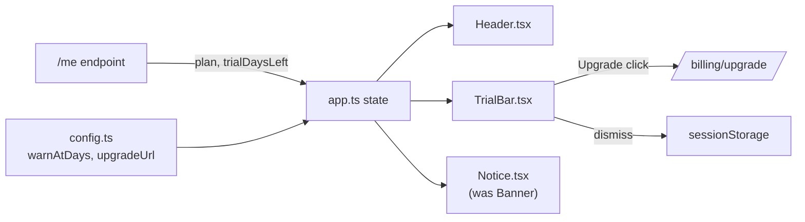

# Trial bar architecture

The trial bar is rendered by `app.ts` from the `/me` payload; no new endpoint is involved.
The amber threshold and the upgrade URL are configuration, not component state.

## Notes

- `TrialBar.tsx` owns only presentation; `dismissTrialBar()` in `app.ts` persists the dismissal.
- `legacy/OldBanner.ts` was deleted; its last caller went away with the navigation rewrite.
- `big.generated.ts` is a regenerated flag registry and should be skimmed, not reviewed line by line.
