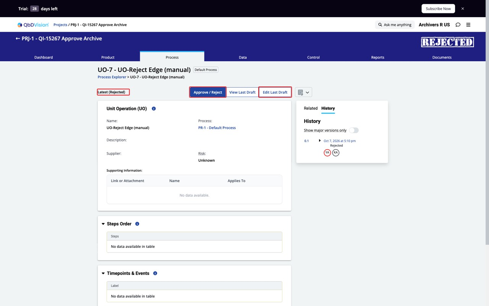
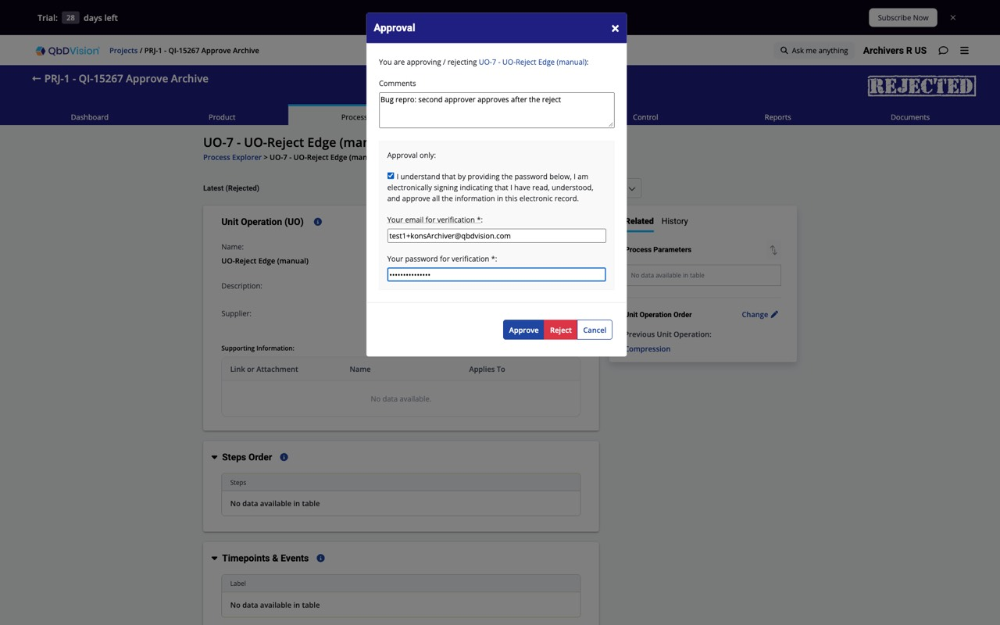
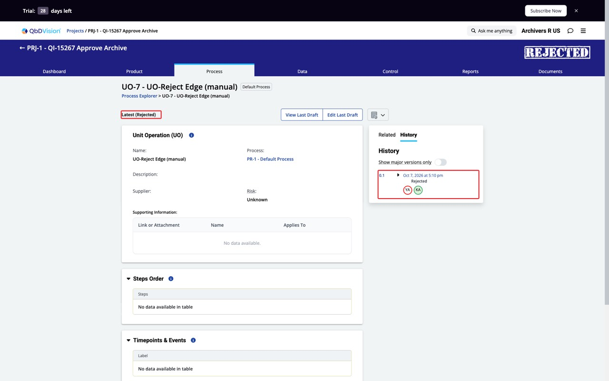
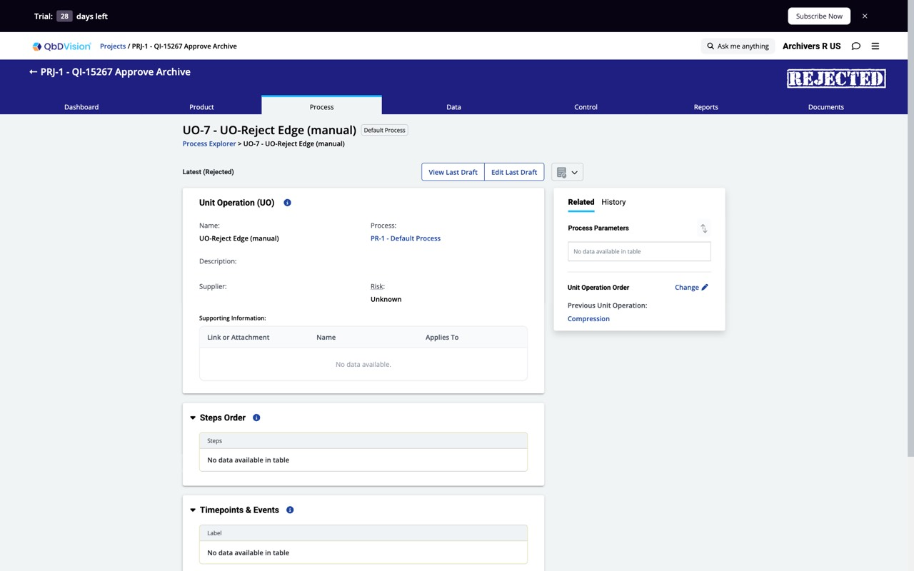

# Approve after a reject is accepted and recorded (two-approver archive request)

Found while testing QI-15267. Happens with `stateManagementServiceApproveForArchive` ON and OFF (UO-7, Archivers R US, approvers Yash + Kons).

## Steps
1. UO-7 is Proposed for Archive with approvers Yash and Kons.
2. Yash opens UO-7 → Approve / Reject → Reject. Record is Rejected.
3. Kons opens UO-7: "Approve / Reject" and "Edit Last Draft" are still shown.
4. Kons approves (e-signature, email, password).

## Expected
After a reject the request is closed: no Approve / Reject for the other approver, or the approve is refused, and no response stored.

## Actual
Approve is accepted silently. `UnitOperationApprovalResponses`: id 1 approve=0 (Yash), id 2 approve=1 (Kons), both on the same transition (15). Record state stays Rejected.

| | Flag ON | Flag OFF |
|---|---|---|
| Buttons after reject | shown | shown |
| Kons approve | accepted, response stored | accepted, response stored |
| Record state | Rejected | Rejected |

## Notes
- Pre-existing (same in the old flow), so not a regression of the new approve-for-archive pipeline.
- A stale second approve on an archived record is refused ("Invalid record state"), so only the reject case lacks the check.
- Single-approver records were not retested (the other approver's buttons are the issue).
