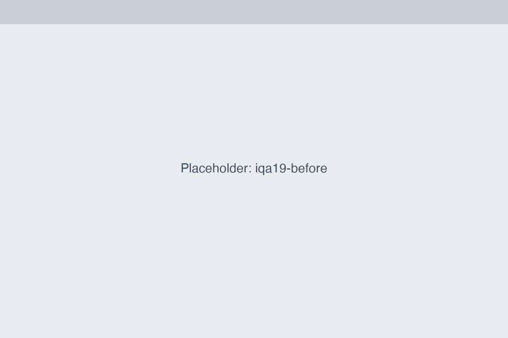
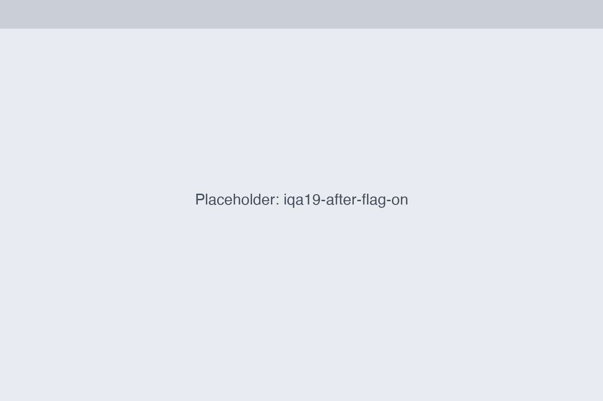
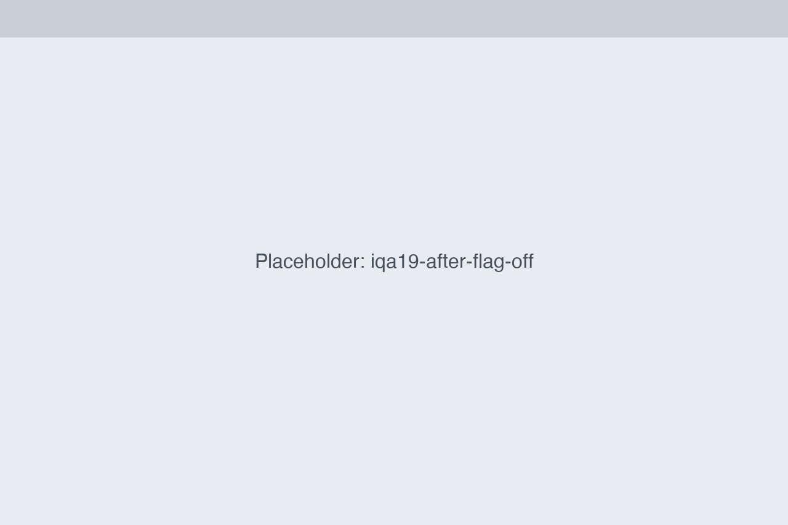
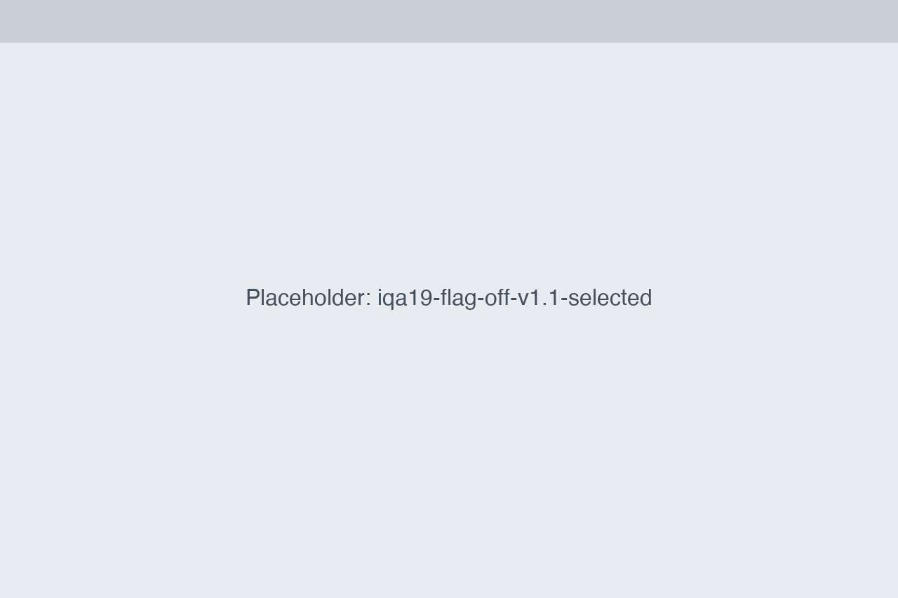
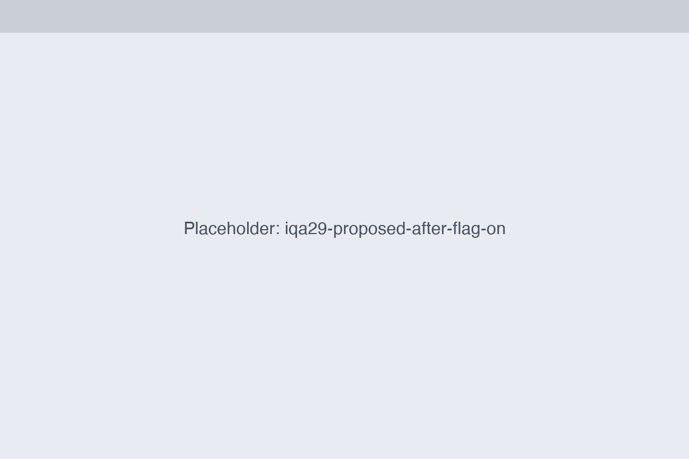
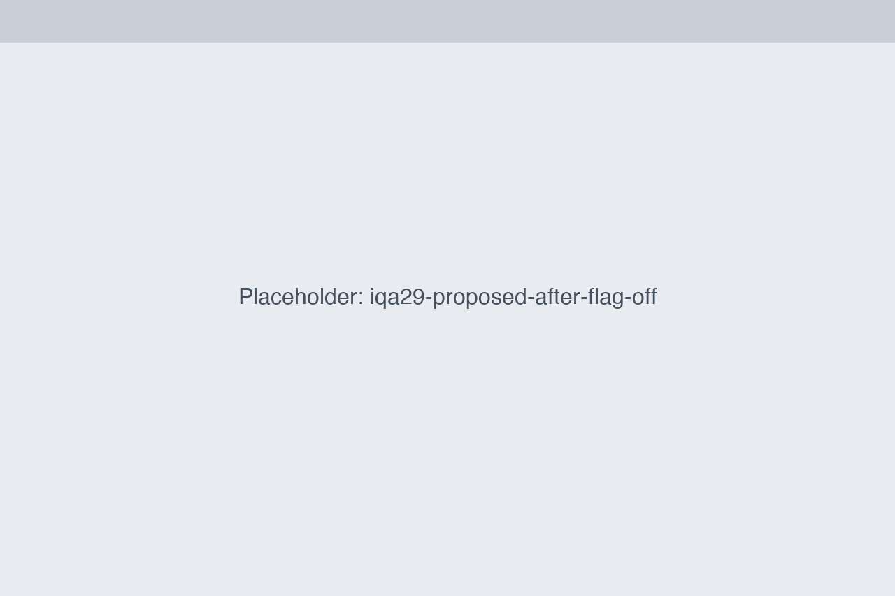
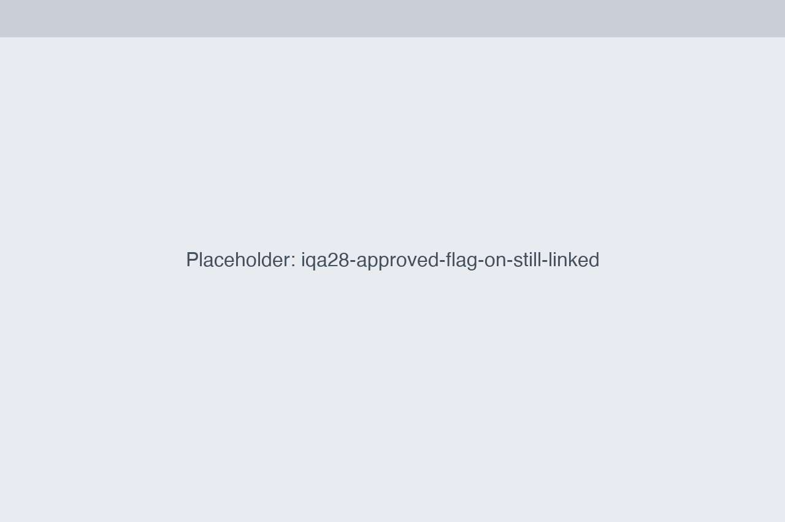
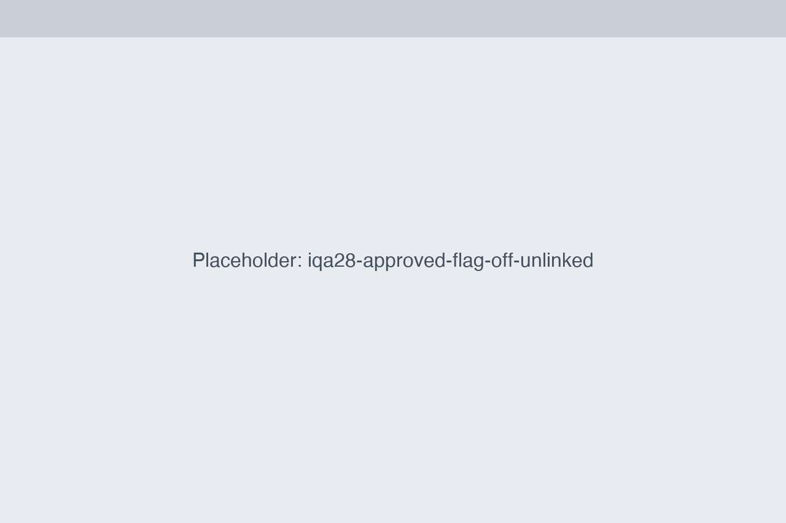

# Approve for Archive: FQA archive does not unlink/re-version an IQA that is itself Proposed for Archive

Found while testing DEMO-15267. Only with `stateManagementServiceApproveForArchive` ON; the old flow (flag OFF) adds a new IQA version.

## Steps
1. Demo Co, project "DEMO-15267 Rich": IQA-19 (Blend Uniformity) has an FQA spec link to FQA-21 (Assay). Both are Approved.
2. As Omar, propose IQA-19 for archive (Process Explorer, IQAs tree, right-click, Archive, approver Priya). Its spec link status becomes NULL.
3. As Omar, propose FQA-21 for archive (Product, Quality Attributes list, row menu, Archive, approver Priya).
4. As Priya, open IQA-19: Approve / Reject is enabled, history is 1.0, 0.2, 0.1.
5. As Priya, open FQA-21 and approve the archive.
6. Open IQA-19 again.

## Expected (legacy)
IQA-19 gets a new version 1.1 "Changed automatically by Foliant. FQA-21 - Assay unlinked as part of the archival of the related record." (legacy `GenericAfterArchival.unlinkFQASpecsWhenArchiving`).

## Actual
FQA-21 is Archived but IQA-19 is untouched: still v83, no 1.1 entry, no "unlinked" comment in its history.

Flag ON (new flow):

Flag OFF (legacy), page opens on the old v1.0 (Approve greyed because it is not the latest version), new v1.1 in the history:

Flag OFF, v1.1 selected in the history (Approve / Reject available):

| | Flag ON (new flow) | Flag OFF (old flow) |
|---|---|---|
| `IQAs.lastVersionId` (IQA 19) | 83, unchanged | 95 (new version 1.1) |
| History | 1.0, 0.2, 0.1 | 1.1 "unlinked as part of the archival of the related record", 1.0, 0.2, 0.1 |
| `IQAToFQALibraryLinkedVersions` | 1 row (version 83) | + 1 row (version 95) |
| `IQAToFQALibraries.status` | NULL (already set by the IQA archive proposal) | NULL |

Evidence: `test-runs/demo-15267-approve-archive-20261012/scenarios/S9-iqa-proposed/` (screenshots with `raw/`, dumps `state-s9n-on-after-fqa.txt`, `state-s9n-off-after-fqa.txt`).

## Also: IQA in Proposed or Routing (second run, FQA-24)
Same skip, bigger consequence. FQA-24 (Approved) with spec links from IQA-29 (Proposed, approver Priya) and IQA-28 (Routing: Priya approved, Dana pending). Dana approves the FQA-24 archive, then the two IQAs are approved.

| | Flag ON (new flow) | Flag OFF (old flow) |
|---|---|---|
| IQA-29 (Proposed) after FQA archive | untouched (v0.2), still shows "Linked to ... FQA-24" | new Proposed version 0.3 "FQA-24 ... unlinked as part of the archival of the related record", link strip gone |
| IQA-28 (Routing) after FQA archive | untouched, Priya's approval kept | reset to Proposed with a new approval request, new "unlinked" version; Priya must approve again |
| After the IQAs' own approvals | both Approved, **spec link still 'Linked' to the archived FQA-24** (`IQAToFQALibraries` rows 3 and 6, page shows the link strip) | both Approved, link NULL, no link strip |

So the assumption in the code comment (the IQA's own approval cleans the link) does not hold: an Approved IQA is left linked to an Archived FQA.

IQA-29 after the FQA archive, flag ON (still linked, no new version) / flag OFF (new 0.3 "unlinked"):

IQA-28 after its own approval, flag ON (Approved, still linked) / flag OFF (Approved, unlinked):

Evidence: `test-runs/demo-15267-approve-archive-20261012/scenarios/S9-iqa-states/` (dumps `state-on-natural-*.txt`, `state-off-natural-*.txt`).

## Likely cause
`UnlinkFQASpecsOnArchivePlugin` skips any IQA in `SKIP_UNLINK_STATES` (Proposed, Proposed for Archive, Proposed for Restore, Routing, Pending) (`src/main/server/stateManagement/plugins/mutations/unlink_fqa_specs_on_archive_plugin.js:15` and `:100`). The comment assumes the link is cleaned up when that IQA's own proposal is approved or rejected. The legacy code has no such skip.

## Notes
- The skip is intentional in the code, so this needs a dev decision: restore parity (re-version the IQA with the unlink comment) or document the change.
- Legacy: the IQA page opens on v1.0, where Approve / Reject is greyed out because it is not the latest version. Selecting 1.1 in the history (`&versionId=95`) enables Approve / Reject (re-run and confirmed). The IQA is not stuck.
- Same data with an Approved, Linked IQA (IQA-27 to FQA-24) behaves the same in both flows: the IQA is re-versioned and the link cleared.
- With the new flow, approving IQA-19's own archive afterwards archives it (v95), link rows NULL.

## Not checked
- IQA in Pending or Proposed for Restore: new flow skips them (states forced by SQL), legacy behaviour not verified (it crashed on the forced data, "Cannot read properties of null (reading 'approvalRequest')", most likely a data artifact).
- Rejecting the IQA's own proposal after the FQA is archived.
- What the stale 'Linked' status does later (e.g. restoring the FQA).
