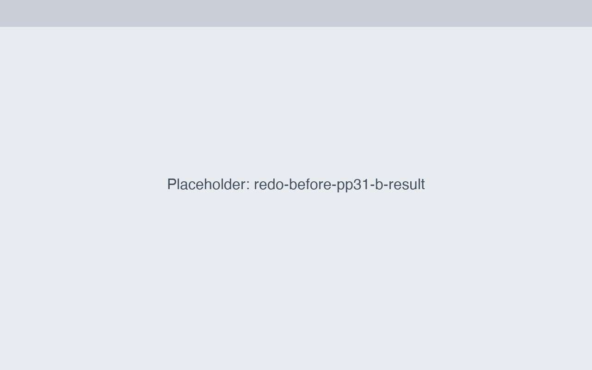
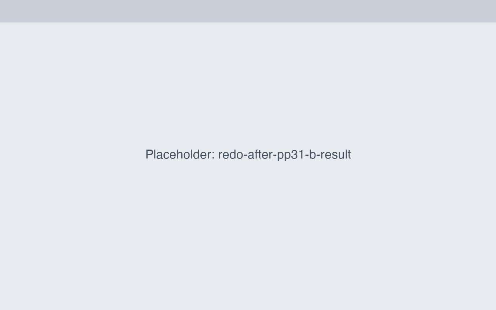
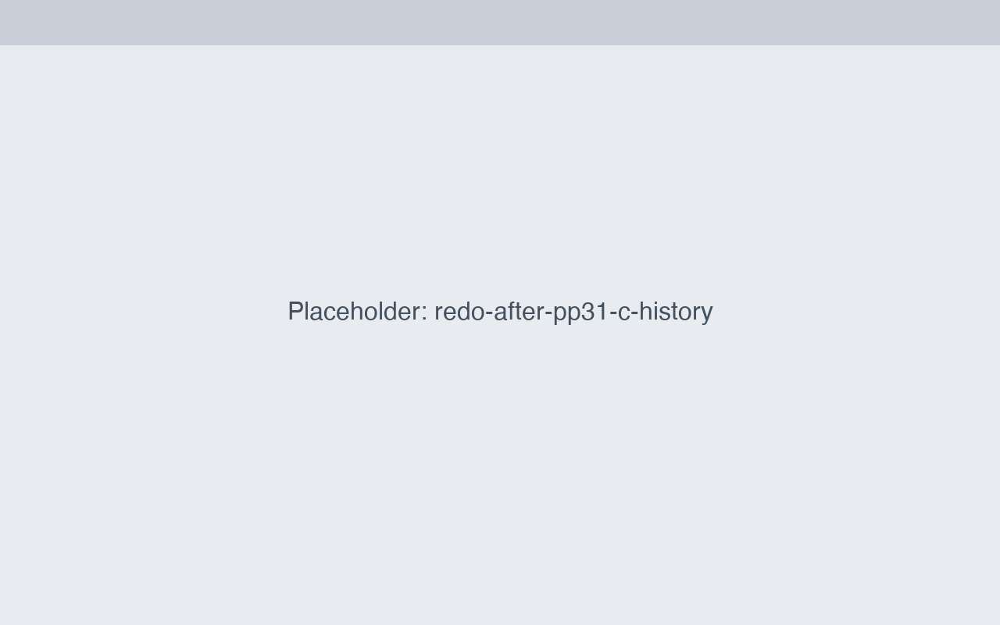
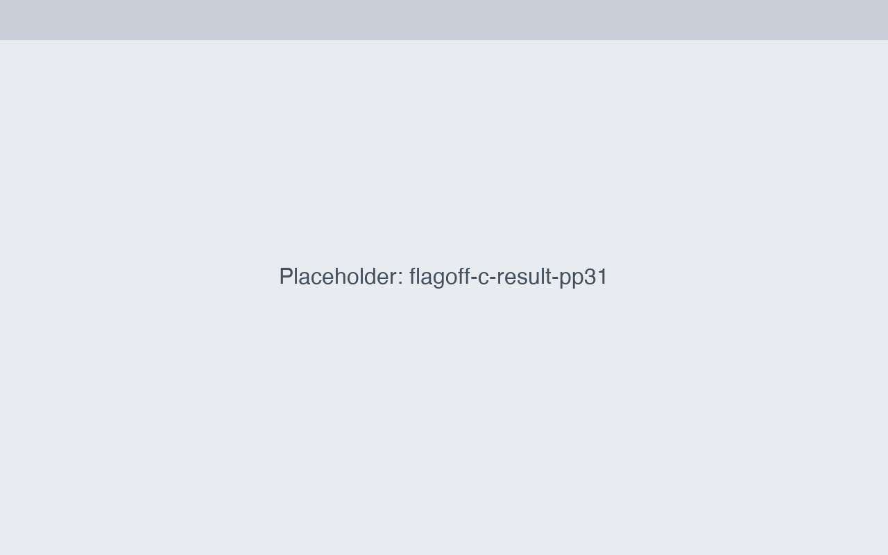
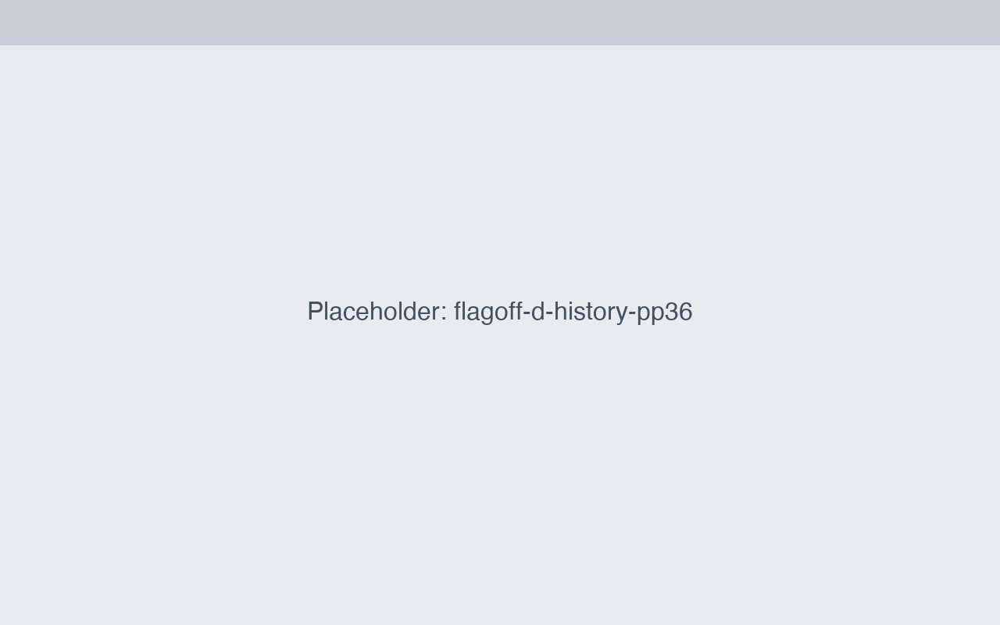

# Approve for Archive: cascaded children show a stale "Latest" label

Found while testing DEMO-15255 (Propose for Archive). Flag: `stateManagementServiceApproveForArchive`.

## Steps
1. Propose a unit operation that has child records for archive (e.g. UO-16, children PP-31..36). Children become **Proposed for Archive (Cascaded)**.
2. Log in as the approver and approve the archive.
3. Open a cascaded child (e.g. PP-31 or PP-36).

## Expected
Badge and the "Latest (…)" label both say **Archived (Cascaded)**.

## Actual
Badge says **Archived (Cascaded)**, but the label says **Latest (Proposed for Archive (Cascaded))**.

## Only with the flag ON
With `stateManagementServiceApproveForArchive` OFF the same steps give "Latest (Archived (Cascaded))", consistent.

## Likely cause
On approval the service creates a new child version (v0.3) that only carries a copied "Proposed for Archive (Cascaded)" transition, while "Archived (Cascaded)" is attached to the old, soft-deleted version (v0.2). The badge reads the record's current state; the label reads the new version's last transition. With the flag OFF no new version is created.
